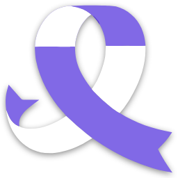
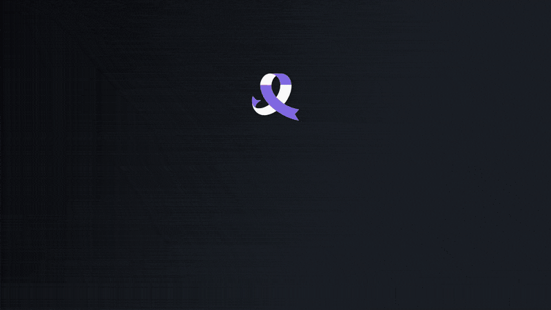

  

<h1 align="center">Ace</h1>

  <b>Reference clips, minus the chaos.</b> 
  Grab any video from the web, keep the three seconds that matter, and drop a GIF into the deck before the coffee gets cold.

  
  &nbsp;
  

  Free · Windows 10 and 11 · macOS 12+ on Apple silicon · updates itself · <a href="https://github.com/xmadbad/ace-releases/releases/latest">What's new</a>

   
  <a href="https://github.com/xmadbad/ace-releases/raw/main/assets/ace-tour.mp4">Watch the tour in full quality (MP4, one minute)</a>

## For creative directors with 214 open tabs

You find the perfect reference at 1 a.m. By the pitch it's "somewhere in Downloads". Ace keeps every clip in the job it belongs to, cut and ready to share.

| | |
|---|---|
| **Grab** | Right-click a video in Chrome → **Ace**. YouTube, Instagram, Pinterest, Vimeo, LinkedIn, X and many more. It lands in your project, not in Downloads/final_FINAL_v3. |
| **Cut** | **I** and **O** mark the moment. The other 57 seconds can stay on the internet. |
| **Fix** | Crop to 9:16 or 4:5. Rotate the one somebody filmed sideways. Make the green screen transparent. |
| **Point** | Arrows, boxes, circles and words, right on the video. "This bit" explains itself. |
| **Ship** | GIF, WebP, MP4, WebM or ProRes. Light enough for Slack, sharp enough for the deck, and squeezed under a max size when the client's inbox is picky. |
| **Sequence** | Line up the best bits and export them as one file for the pitch. No editing software was harmed. |
| **Stay sane** | One folder per job, saved as you go. Ctrl+Z for second thoughts. |

## Install in a minute

**Windows.** Run `Ace-Setup.exe`. Windows gets cautious ("Windows protected your PC"): click **More info**, then **Run anyway**. The installer isn't signed yet; it's shy, not shady.

**Mac (Apple silicon).** Open `Ace-mac.dmg` and drag Ace to Applications. The first time, macOS says no: **System Settings → Privacy & Security → Open Anyway**.

**Chrome.** After the short tour Ace offers its browser extension: three steps, and it ticks them off as you go.

From then on Ace keeps itself up to date: a **New version** button shows up at the top right.

## Questions people ask

**Is it really free?** Yes, for personal and commercial work. What you make with it is yours.

**Does it send my work anywhere?** No. It downloads what you ask for, and looks here for new versions. That's the whole guest list.

**Intel Mac?** Not for now: Apple silicon only.

**Something didn't download?** The failed row has a **Report** button. Send it our way.

---

© 2026 Studio Whirl Motion Ltd. Ace is free to use, for personal or commercial work; please don't share, change, sell or re-upload Ace itself. Ace runs ffmpeg, yt-dlp, gifsicle and libwebp, each under its own license.
